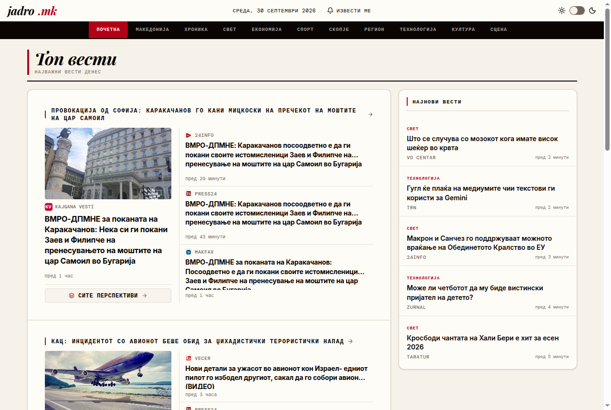

# Jadro

**Jadro** (Macedonian *јадро*, "core") is a self-hostable news aggregator that groups articles about the same story from many outlets, so you can read one event from every angle.

It reads RSS feeds, embeds each headline with a multilingual sentence model, clusters related articles with pgvector, ranks the stories and serves them through a fast React front end. It also has server-rendered pages for search engines and optional Web Push notifications.

**Live deployment:** [jadro.mk](https://jadro.mk), covering Macedonian news from 70+ sources.



[](https://github.com/MatejGadjo/jadro/actions/workflows/test.yml)
[](LICENSE)

---

## Features

- **Story clustering**: articles about the same event are grouped across outlets using sentence embeddings (ONNX Runtime, 384-dim) and cosine similarity in PostgreSQL + pgvector.
- **Ranking**: stories are scored by coverage, source diversity, recency and velocity.
- **Topic classification**: rule-based topic detection from RSS categories, URL patterns and keywords.
- **Fast feed**: Redis read-through cache, rebuilt after every ingest.
- **SEO**: crawlers get server-rendered HTML and a dynamic sitemap, while people get the SPA.
- **Web Push** (optional): a daily notification with the top story.
- **No accounts, no tracking by default**: analytics only load if you set a GA4 ID.

## Architecture

```
            ┌───────────── ingest (cron, every 15 min) ─────────────┐
 RSS feeds ─┤ fetch → normalize → classify topic → store (Postgres) │
            └──────────────────────┬────────────────────────────────┘
                                   ▼
            embed (ONNX, worker pool) → cluster (pgvector ANN) → rank
                                   ▼
 browser ─▶ nginx ─┬─▶ React SPA (static)
                   ├─▶ Go API /api/*  ──▶ Redis cache ──▶ Postgres
                   └─▶ /_prerender/* (crawlers only) + /sitemap.xml
```

| Layer | Tech |
|---|---|
| Backend | Go 1.25, Gin, uber/fx, pgx + sqlc, goose migrations, robfig/cron |
| ML | ONNX Runtime + `paraphrase-multilingual-MiniLM-L12-v2` (50+ languages) |
| Data | PostgreSQL 17 + pgvector, Redis 7 |
| Frontend | React 19, Vite, TanStack Router + Query, Tailwind, shadcn/ui, zod |
| Edge | nginx (reverse proxy, rate limits, crawler routing) |

More detail: [docs/ARCHITECTURE.md](docs/ARCHITECTURE.md).

## Quick start

You need **Docker** (with Compose v2), **make**, **curl** and about **2 GB** of free disk.

```bash
git clone https://github.com/MatejGadjo/jadro.git
cd jadro

make setup    # creates .env files from the examples
make models   # downloads the embedding model + ONNX Runtime (~480 MB, checksum-verified)
make up       # builds and starts everything
```

Open **http://localhost:8000**. The first ingest starts right away (`INGEST_ON_START=true` in `.env`). Articles show up in a few seconds, and story clusters fill in over the next few minutes as embeddings are computed.

```bash
make logs     # follow the backend
make down     # stop (data is kept in a Docker volume)
```

> **Apple Silicon / ARM:** `make models` detects your CPU and prints `ORT_ARCH=aarch64`. Put that in `.env` before `make up`.
>
> **Port or network already in use?** Set `HTTP_PORT`, `POSTGRES_PORT`, `REDIS_PORT` or `DOCKER_SUBNET` in `.env` (see [.env.example](.env.example)).

The embedding model is **required**: without it articles are still ingested, but nothing gets clustered and the feed stays empty.

## Local development

Run Postgres + Redis in Docker and the apps natively, with hot reload:

```bash
make dev-deps       # Postgres :5432 + Redis :6379
make dev-backend    # Go API on :8080 (reads backend/.env)
make dev-frontend   # Vite on :5173 (reads frontend/.env)
```

Native backend development with embeddings needs Linux x64 (the downloaded runtime is a Linux library). On macOS, use `make up` for the full stack, or leave `ONNX_RUNTIME_LIB_PATH` empty to work on everything except clustering.

```bash
make test   # go test -race + vitest
make lint   # golangci-lint + eslint + tsc
```

See [CONTRIBUTING.md](CONTRIBUTING.md) for the SQL/sqlc workflow and conventions.

## Configuration

Everything is configured through environment variables. The documented defaults are in [.env.example](.env.example) (Docker), [backend/.env.example](backend/.env.example) and [frontend/.env.example](frontend/.env.example). The most important ones:

| Variable | Default | Purpose |
|---|---|---|
| `POSTGRES_PASSWORD` | — | **Required.** Database password |
| `APP_ENV` | `development` | `production` switches to JSON logs and stricter warnings |
| `ALLOWED_ORIGINS` | *(any)* | Comma-separated CORS origins; set to your domain in production |
| `INGEST_CRON` / `INGEST_ON_START` | `*/15 * * * *` / `false` | Ingest schedule / run once on boot |
| `CLEANUP_RETENTION_DAYS` | `3` | How long articles are kept |
| `VAPID_PUBLIC_KEY` / `VAPID_PRIVATE_KEY` / `VAPID_SUBJECT` | — | Enable Web Push (`make vapid`) |
| `VITE_GA_MEASUREMENT_ID` | — | Google Analytics 4; empty disables analytics |

## API

All endpoints are public, read-mostly and rate-limited per IP (nginx and Redis).

| Method | Path | Description |
|---|---|---|
| `GET` | `/api/health` | Health: DB, Redis, counts, embedding status |
| `GET` | `/api/feed?topic=&page=` | Ranked story feed (page 0–100) |
| `GET` | `/api/clusters/:id` | One story with all its articles |
| `GET` | `/api/articles/latest?limit=` | Newest articles (max 20) |
| `PATCH` | `/api/articles/:id/clear-image` | Report a broken image; the server verifies it before clearing |
| `GET` | `/api/push/config` | VAPID public key (404 when push is off) |
| `POST` | `/api/push/subscribe`, `/api/push/unsubscribe` | Manage a Web Push subscription |

## Running it for your country or language

The model already understands 50+ languages, so the ML side needs no changes. Today the Macedonian specifics live in data and a few constants:

- **Sources**: `backend/internal/storage/migrations/00007_seed_sources.sql`
- **Topics**: `backend/internal/topics/taxonomy.go`, the JSON rules in `backend/internal/topics/config/`, and `frontend/src/lib/topics.ts`
- **Stopwords** used for cluster titles: `backend/internal/clustering/incremental.go`
- **UI text, branding and legal pages**: `frontend/src/`, `frontend/index.html`, `frontend/public/manifest.json`, and `backend/internal/rest/handlers/templates/`

Making this configurable through "locale packs" is the first item on the roadmap. Contributions are very welcome.

## Deploying

A generic guide for a single server (with or without a CDN in front) is in [docs/DEPLOYMENT.md](docs/DEPLOYMENT.md). Please read the security checklist in it before exposing an instance to the internet.

## Content and takedowns

Jadro stores and shows only headlines, short snippets, thumbnail links and links back to the original articles. All content belongs to its publishers. If you run a public instance, honour publishers' requests to be removed. For jadro.mk, open an issue on this repository.

## Contributing and security

- Contributions: see [CONTRIBUTING.md](CONTRIBUTING.md) and the [Code of Conduct](CODE_OF_CONDUCT.md).
- Found a vulnerability? Please **don't** open an issue. See [SECURITY.md](SECURITY.md).

## License

[MIT](LICENSE) © 2026 Matej Gadjovski. The embedding model (Apache-2.0) and ONNX Runtime (MIT) are downloaded separately and keep their own licenses.
